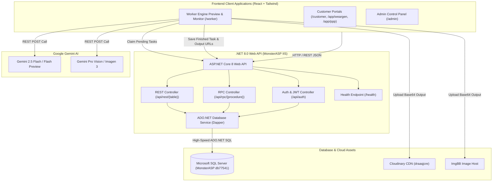

# AI Studio: System Architecture

## Overview
AI Studio is an enterprise AI image generation and photography transformation system powered by a high-performance **ASP.NET Core 8 Web API**, **Microsoft SQL Server**, and a modern **React (Tailwind CSS)** frontend with an autonomous **Dynamic Auto-Scaling Worker Engine**.

---

## 🏛️ High-Level System Architecture

---

## 🧩 Architectural Layers

### 1. Presentation Layer (Frontend Clients)
- **Admin Dashboard (`AI Studio Admin.jsx`)**: System monitoring, workers oversight, live task queue, tool catalog, app mappings, global settings, and audit logs.
- **Customer Portals (`AI Studio Customer.jsx`, `StandaloneAppPage.jsx`)**: Multi-app scoped interfaces for WearGen and PPP customers. Supports one-click photo creation, multi-pose batches, raw JSON inspector, and conversational chat.
- **Worker Engine UI (`AI Studio Worker.jsx`)**: Autonomous browser or server worker with live memory monitoring, queue claiming, Gemini dispatch, and Cloudinary uploads.

### 2. Application & API Layer (ASP.NET Core 8)
- **Host**: Windows Server IIS on MonsterASP (`https://aistudio.runasp.net`).
- **REST Controller**: Translates client queries (`select`, `eq`, `order`, `limit`, `offset`) into parameterized SQL queries on tables.
- **RPC Controller**: Direct execution of business procedures (`upload_ai_studio_task`, `get_pending_for_worker`, `claim_ai_studio_task`, `worker_complete_task`, `worker_heartbeat`, `get_task_catalog`, etc.).
- **ADO.NET & Dapper**: Direct, lightweight database interaction delivering sub-15ms response times.

### 3. Data & Storage Layer
- **Database**: Microsoft SQL Server (`db77541.public.databaseasp.net`).
- **Media Hosting**: Cloudinary CDN with preset `ml_default` for reliable, permanent public image delivery.
- **AI Processing**: Google Generative Language API (Gemini models) for multimodal image generation and analysis.
